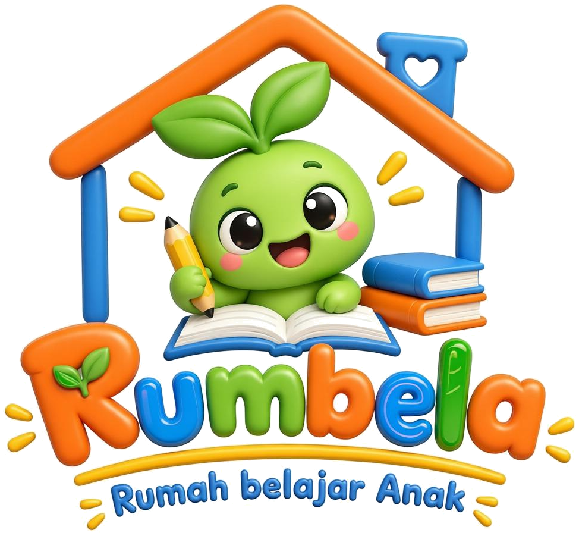

# 🌱 Rumbela English Quest

Game belajar Bahasa Inggris interaktif untuk **Bimbel Rumbela - Rumah belajar Anak**. Dibuat dengan Next.js 16 + TypeScript + Tailwind CSS + shadcn/ui, lengkap dengan maskot animasi **Bela** si kecambah hijau.



---

## 🎮 Fitur Utama

### 4 Mode Permainan
| Mode | Icon | Deskripsi |
|------|------|-----------|
| **Quiz Challenge** | 🧠 | Pilihan ganda dengan timer countdown |
| **Word Match** | 🔗 | Cocokkan kata Inggris dengan arti Indonesianya |
| **Fill the Blank** | ✏️ | Lengkapi kalimat yang kosong |
| **Spell Master** | 🔤 | Eja kata Bahasa Inggris dengan benar |

### 3 Kategori Materi
- 📚 **Vocabulary** — hewan, makanan, warna, keluarga, sinonim/antonim
- ✏️ **Grammar** — article, tense, preposition, conditional, passive voice
- 💬 **Daily Conversation** — sapaan, arah, belanja, wawancara kerja

### 3 Level Kesulitan
- 🌱 **Beginner** — 5 nyawa, 30 detik, 1× poin
- ⚡ **Intermediate** — 4 nyawa, 25 detik, 1.5× poin
- 🔥 **Advanced** — 3 nyawa, 20 detik, 2× poin

### Engagement & Gamifikasi
- ❤️ **Sistem nyawa** (heart) dengan animasi
- ⭐ **Skor dinamis** — poin dasar + bonus kecepatan + bonus streak
- 🔥 **Streak counter** dengan multiplier
- 🎖️ **8 Achievement badges** untuk dibuka
- 🏆 **Leaderboard** top 50 (tersimpan di localStorage browser)
- 🌱 **Maskot Bela beranimasi** — mata berkedip, kepala bergoyang, daun bergerak
- 🎉 **Confetti** saat skor tinggi
- 🔊 **Sound effects** (Web Audio API, tanpa file eksternal)
- 💬 **Mascot reaction** — Bela bereaksi sesuai hasil jawaban

---

## 🛠️ Tech Stack

| Kategori | Teknologi |
|----------|-----------|
| Framework | Next.js 16 (App Router) |
| Bahasa | TypeScript 5 |
| Styling | Tailwind CSS 4 + shadcn/ui |
| Animasi | Framer Motion |
| Canvas | HTML5 Canvas (background animasi & confetti) |
| Audio | Web Audio API |
| State Management | Zustand |
| Persistence | localStorage |
| Icons | Lucide React |
| Package Manager | Bun |

---

## 📦 Instalasi

### Prasyarat
- **Node.js** 18.17+ atau **Bun** 1.0+
- Git

### Langkah Instalasi

```bash
# 1. Clone repository
git clone https://github.com/USERNAME/rumbela-english-quest.git
cd rumbela-english-quest

# 2. Install dependencies (pilih salah satu)
bun install        # direkomendasikan (cepat)
# atau
npm install
# atau
pnpm install

# 3. Jalankan development server
bun run dev
# atau
npm run dev

# 4. Buka browser
# http://localhost:3000
```

---

## 🚀 Cara Pakai

### Untuk Siswa
1. Buka aplikasi di browser
2. Ketik namamu
3. Pilih kategori (Vocabulary / Grammar / Daily Conversation)
4. Pilih level kesulitan (Beginner / Intermediate / Advanced)
5. Pilih mode permainan (Quiz / Match / Fill Blank / Spell)
6. Klik tombol **"🚀 Mulai Petualangan"**
7. Mainkan dan kumpulkan poin + achievement!

### Untuk Guru Bimbel
- **Tidak perlu login** — siswa langsung main
- **Progres otomatis** tersimpan di browser masing-masing
- **Responsif mobile** — bisa dimainkan di HP / tablet / laptop
- **Leaderboard kompetitif** — siswa berlomba naik peringkat
- **Bisa jadi PR seru** — suruh siswa capai skor tertentu

---

## 📁 Struktur Project

```
rumbela-english-quest/
├── public/
│   └── rumbela/
│       ├── logo-full.png              # Logo utuh Rumbela
│       ├── mascot-base.png            # Maskot statis (favicon)
│       └── mascot-bela-animated.webp  # Maskot animasi 6-frame
├── src/
│   ├── app/
│   │   ├── layout.tsx                 # Root layout + metadata
│   │   ├── page.tsx                   # Main orchestrator (home/playing/result)
│   │   └── globals.css                # Tailwind global styles
│   ├── components/
│   │   ├── ui/                         # shadcn/ui components
│   │   └── game/
│   │       ├── AnimatedBackground.tsx  # Canvas huruf melayang
│   │       ├── Confetti.tsx            # Animasi konfeti
│   │       ├── Mascot.tsx              # Maskot Bela (animated WebP)
│   │       ├── HUD.tsx                 # Skor, nyawa, streak, timer
│   │       ├── HomeScreen.tsx          # Halaman utama + leaderboard
│   │       ├── QuizMode.tsx            # Mode kuis pilihan ganda
│   │       ├── WordMatchMode.tsx       # Mode cocokkan kata
│   │       ├── FillBlankMode.tsx       # Mode isi kalimat kosong
│   │       ├── SpellMode.tsx           # Mode mengeja
│   │       └── ResultScreen.tsx        # Hasil akhir + achievement
│   └── lib/
│       ├── game-data.ts                # 30+ soal Bahasa Inggris
│       ├── game-store.ts               # Zustand store + localStorage
│       ├── sound.ts                    # Sound manager (Web Audio API)
│       └── utils.ts                    # Utility functions
├── prisma/
│   └── schema.prisma                   # (opsional, untuk DB)
├── package.json
├── tsconfig.json
├── tailwind.config.ts
└── next.config.ts
```

---

## 🎖️ Daftar Achievement

| Icon | Nama | Cara Buka |
|------|------|-----------|
| 🎯 | First Step | Selesaikan game pertamamu |
| 💯 | Century | Raih total skor 100 |
| 🏆 | Master Mind | Raih total skor 500 |
| 🔥 | On Fire | 5 jawaban benar beruntun |
| ⚡ | Unstoppable | 10 jawaban benar beruntun |
| ✨ | Perfectionist | Selesaikan 1 game dengan skor sempurna |
| 🗺️ | Explorer | Mainkan semua kategori |
| 🎖️ | Veteran | Selesaikan 10 game |

---

## 🧑‍💻 Development

### Menambah Soal Baru
Edit `src/lib/game-data.ts` dan tambah entry ke array yang sesuai:

```typescript
// Contoh: tambah soal Quiz baru
{
  id: "q-v-b-99",
  type: "multiple-choice",
  category: "vocabulary",
  difficulty: "beginner",
  question: "What is the English word for 'sekolah'?",
  questionTranslation: "Apa kata Bahasa Inggris untuk 'sekolah'?",
  options: ["Hospital", "School", "Market", "Office"],
  answer: 1,
  explanation: "'School' artinya sekolah.",
  points: 10,
}
```

### Menambah Achievement Baru
Edit `src/lib/game-data.ts`, tambah ke array `ACHIEVEMENTS`:

```typescript
{
  id: "score-1000",
  name: "Legend",
  icon: "👑",
  description: "Raih total skor 1000",
  condition: (s) => s.totalScore >= 1000,
}
```

### Menambah Kategori Baru
Edit `src/lib/game-data.ts`, tambah ke `CATEGORIES` dan type `CategoryId`.

---

## 📝 Scripts yang Tersedia

```bash
bun run dev          # Development server (port 3000)
bun run build        # Production build
bun run start        # Run production server
bun run lint         # ESLint check
bun run db:push      # Push Prisma schema ke DB
bun run db:generate  # Generate Prisma client
```

---

## 🌐 Deploy

### Deploy ke Vercel (direkomendasikan)
1. Push repo ke GitHub
2. Buka [vercel.com](https://vercel.com) → "New Project"
3. Import repo dari GitHub
4. Klik "Deploy" (otomatis deteksi Next.js)
5. Tunggu ~2 menit → aplikasi online!

### Deploy ke Netlify
1. Push repo ke GitHub
2. Buka [netlify.com](https://netlify.com) → "Add new site" → "Import existing project"
3. Pilih repo, set build command: `npm run build`
4. Set publish directory: `.next/`
5. Deploy

### Deploy ke platform lain
Lihat [Next.js deployment docs](https://nextjs.org/docs/app/building-your-application/deploying).

---

## 📄 Lisensi

MIT License - bebas dipakai, dimodifikasi, dan didistribusikan.

---

## 🙏 Credits

- **Bimbel Rumbela** - Rumah belajar Anak - Konsep & branding
- **Maskot Bela** - Karakter kecambah hijau Rumbela
- Dibangun dengan ❤️ menggunakan [Next.js](https://nextjs.org) + [Tailwind CSS](https://tailwindcss.com) + [shadcn/ui](https://ui.shadcn.com)

---

## 📞 Kontak

Pertanyaan? Saran? Mau tambah fitur?
- Issue: [GitHub Issues](../../issues)
- Email: contact@rumbela.id

---

**Selamat belajar Bahasa Inggris bareng Bela! 🌱✨**
